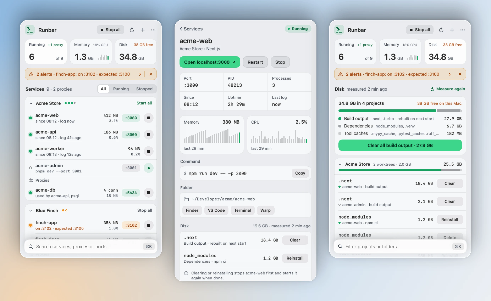
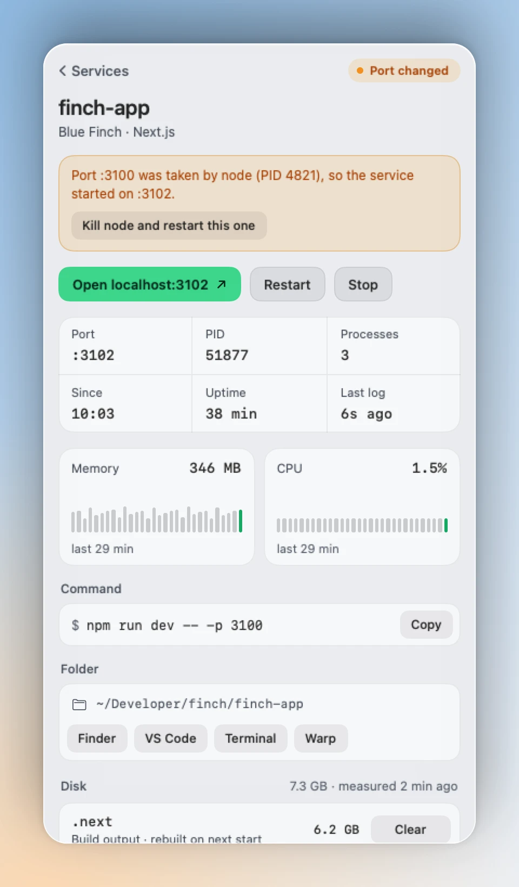
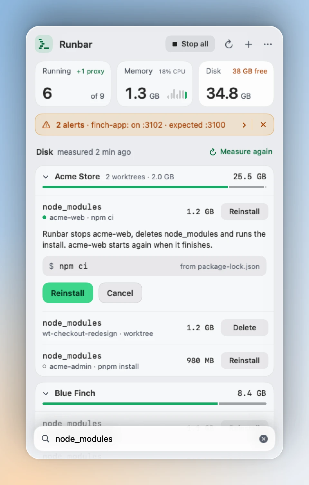
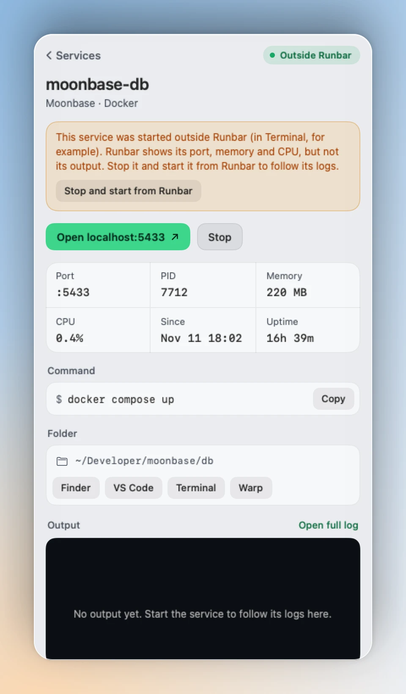
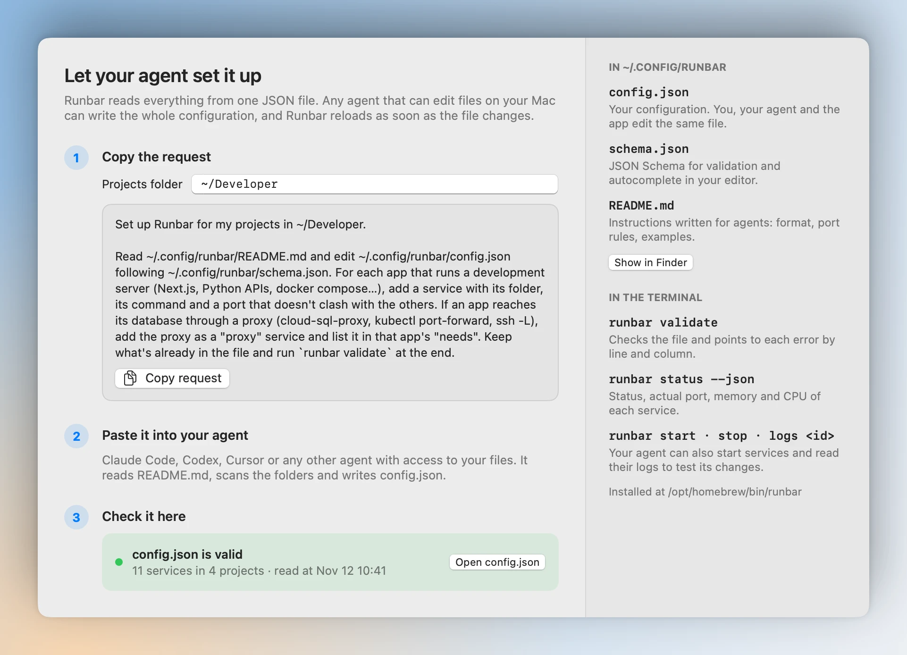
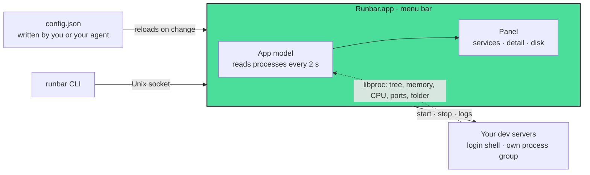

<div align="center">

<picture>
  <source media="(prefers-color-scheme: dark)" srcset="docs/assets/logo-dark.svg">
  
</picture>

**Every dev server on your Mac, one click from the menu bar.**


[](LICENSE)
<br>


</div>

<picture>
  <source media="(prefers-color-scheme: dark)" srcset="docs/assets/hero-dark.webp">
  
</picture>

## Why

<table>
  <tr>
    <td align="center" width="33%"><h3>One place</h3>Next.js apps, Python APIs and docker compose stacks from every project, started and watched from the menu bar</td>
    <td align="center" width="33%"><h3>Ports that explain themselves</h3>When a port is taken, Runbar says by whom and fixes it in one click</td>
    <td align="center" width="33%"><h3>Disk back</h3>See what <code>node_modules</code>, <code>.next</code> and <code>.venv</code> take per project, and clear or reinstall them</td>
  </tr>
</table>

Runbar lists every dev server you work with, grouped by project, with the port it is **really** listening on,
its memory and CPU. Everything comes from one `config.json` that **your coding agent can write for you**, and
a `runbar` command lets you, and your agent, start, stop and read logs from the Terminal.

## Features

**Services**
- Start, stop and restart one service or a whole project. Services run in a login shell, in their own
  process group, with their output in `~/Library/Logs/Runbar`.
- Live status, real port, memory and CPU (the process and its children), with 30 minutes of history.
- The detail view has the PID, uptime, last log, command, folder (open it in Finder, VS Code, a terminal…)
  and the live output.
- Services outlive Runbar: quitting or updating the app leaves them running, and it picks them up again
  when it opens. Optional restart on crash, health checks, and starting with Runbar (`autostart`).
- Each service shows what it runs (Next.js, Node, Python, Postgres, Docker…), from its `type`, a proxy's
  database or the framework in `package.json`. Brand marks from [Simple Icons](https://simpleicons.org) (CC0).
- Projects with something running come first (`settings.activeProjectsFirst`, on by default, also in ⋯).
  The order is set when the panel opens, so nothing moves under the pointer.
- Search stays out of the way until you press ⌘K, click the magnifier or just start typing a name or a port.
- Runbar lives in the menu bar. **Show in Dock** (in ⋯) puts it in the Dock and the app switcher too, and a
  click on the Dock icon opens the panel.

**Ports**
- A taken port says who holds it, with a one-click fix: stop that service, or end that process, and restart.
  Alerts gather under **Needs you** at the top of the panel, each with its fix beside it.
- With `autoPort`, a service whose port is taken starts on the next free one.
- Services started outside Runbar (in Terminal, for example) are recognized by their folder.
- Ports held by other processes are listed, and the menu bar icon flags alerts.
- A port held by a LaunchAgent with `KeepAlive` says so (Kill wouldn't stick), and can be turned off or moved
  into Runbar.

**Proxies**
- Cloud SQL proxies, `kubectl port-forward` and SSH tunnels as services with `"type": "proxy"`: they open when a
  service that `needs` them starts, and close after `idle` (15 minutes by default) with no connections.
- Each proxy shows who is connected through it: a Runbar service, `psql`, TablePlus.
- An expired `gcloud` sign-in shows as such, with a button that signs in again; the proxy reopens on its own.

**Disk**
- What each project folder holds in build output (`.next`, `.turbo`, Rust and Maven `target`…),
  dependencies (`node_modules`, `.venv`) and tool caches (`.mypy_cache`…), git worktrees included.
- **Clear**, **Reinstall** or **Delete** per folder. Reinstall runs the command picked from the lockfile
  (`npm ci`, `pnpm`, `yarn`, `bun`, `uv sync`, or a new `.venv` from `requirements.txt` with the same Python).
- Running services that use the folder are stopped first and started again when it's done.
- Only known folder names, never a symlink, never outside the project. Generic names like `build`, `dist`
  or `.cache` are never touched.

**Coffee mode**
- The cup in the header keeps the Mac from sleeping while you're away and an agent is still working,
  **lid closed included**. Locked isn't asleep: the display still turns off and locks, and everything keeps
  running. While it's on, a strip in the panel says what it covers, with Turn off, and the `>_` in the menu
  bar turns green.
- **No lock**, in that strip, keeps the screen on and unlocked too, the way a playing video does: the display
  doesn't dim, the screen saver doesn't start and nothing locks until you lock it or close the lid. Runbar
  remembers the choice for next time.
- Not sleeping when idle needs nothing special. Not sleeping when the lid closes takes the kernel's
  `SleepDisabled` switch (`pmset -a disablesleep`), which only root can set: the first time, macOS asks for
  your password to install `/etc/sudoers.d/runbar`, which allows exactly `pmset -a disablesleep 1` and `0`.
- That switch also stops the Mac sleeping for low battery or heat, so coffee mode turns itself off at 15%
  battery or when the Mac gets critically hot, and tells you. If Runbar quits, crashes or is killed, the
  switch goes back off on its own.

## Screens

<table>
  <tr>
    <td width="33%" valign="top">
      <picture>
        <source media="(prefers-color-scheme: dark)" srcset="docs/assets/conflict-dark.webp">
        
      </picture>
      <b>Port conflicts</b>: who holds the port, and the fix
    </td>
    <td width="33%" valign="top">
      <picture>
        <source media="(prefers-color-scheme: dark)" srcset="docs/assets/reinstall-dark.webp">
        
      </picture>
      <b>Reinstall</b>: the exact command, before anything is deleted
    </td>
    <td width="33%" valign="top">
      <picture>
        <source media="(prefers-color-scheme: dark)" srcset="docs/assets/outside-dark.webp">
        
      </picture>
      <b>Started elsewhere</b>: port, memory and CPU of what you ran in a terminal
    </td>
  </tr>
  <tr>
    <td colspan="3">
      <picture>
        <source media="(prefers-color-scheme: dark)" srcset="docs/assets/agent-dark.webp">
        
      </picture>
      <b>Set up with an agent</b>: one request to paste into Claude Code, Codex or Cursor
    </td>
  </tr>
</table>

> [!NOTE]
> **The screenshots use made-up projects** (Fellowship, Rivendell, Mordor, The Shire). `make screenshots`
> redraws them from that demo data in `Sources/RunbarApp/DemoShots.swift`, which only debug builds include.

## Configure it with your agent

Everything comes from `~/.config/runbar/config.json`. Next to it the app keeps a `schema.json` and a
`README.md` written for agents, and it reloads as soon as the file changes. **Set up with an agent…** has a
ready-made request: paste it into your agent and it scans your folders and writes the file.

```json
{
  "$schema": "./schema.json",
  "version": 1,
  "projects": {
    "fellowship": {
      "name": "Fellowship",
      "root": "~/Developer/fellowship",
      "services": {
        "gandalf-app": { "cwd": "gandalf-app", "type": "nextjs", "command": "npm run dev -- -p {port}", "port": 3000 },
        "aragorn-api": { "cwd": "aragorn-api", "type": "python", "command": ".venv/bin/uvicorn app.main:app --reload --port {port}",
                      "port": 8000, "open": "http://localhost:{port}/docs", "restart": "on-crash" },
        "boromir-db":  { "cwd": "db", "type": "docker", "command": "docker compose up", "stop": "docker compose down", "port": 5433 }
      }
    }
  }
}
```

The full format, with `env`, `envFile`, `health`, `autostart`, `autoPort` and `install`, is in
[`Sources/RunbarCore/BundledDocs.swift`](Sources/RunbarCore/BundledDocs.swift), the same text the app writes
to `~/.config/runbar/README.md`. `runbar validate` points to each error by line and column.

## Command line

```
$ runbar status
SERVICE                 STATUS          PORT    MEM       CPU     SINCE
gandalf-app             running         :3000   412 MB    3.1%    08:12
aragorn-api             running         :8000   186 MB    0.6%    08:12
legolas-worker          running         —       96 MB     0.2%    08:13
gimli-admin             stopped         :3001   —         —
elrond-app              running         :3102   356 MB    1.8%    10:03  ⚠ on :3102 · expected :3100
arwen-docs              starting        :3101   64 MB     12.0%   10:40
sauron-api              crashed         :8100   —         —         ⚠ Crashed — exit code 1 · ModuleNotFoundError: No module named 'httpx'
saruman-db              outside Runbar  :5433   220 MB    0.4%    Nov 11 18:02
frodo-site              stopped         :4321   —         —
```

<details>
<summary><b>All commands</b></summary>

| Command | What it does |
|---|---|
| `runbar validate [file] [--json]` | Checks config.json (line and column of each error) |
| `runbar status [--json]` | Status, real port, memory and CPU of each service |
| `runbar start <id> [--wait]` | Starts a service (`--wait` waits for the port to open) |
| `runbar stop <id>` | Stops the service and its child processes |
| `runbar restart <id> [--wait]` | Restarts a service |
| `runbar open <id> [--wait]` / `runbar close <id>` | Opens or closes a proxy (same as start and stop) |
| `runbar logs <id> [-n 100] [-f]` | Shows the service's output (`-f` follows it) |
| `runbar reload` | Makes the app reread config.json now |
| `runbar path` | Shows the config folder |

If the app is closed, `start`, `stop` and `restart` open it first. `--json` is there for agents.

</details>

## How it works



<details>
<summary><b>Where things live</b></summary>

| Part | Where |
|---|---|
| JSON parser with line/column, and config validation | `Sources/RunbarCore/JSON.swift`, `Config.swift` |
| Processes: tree, memory (phys_footprint), CPU, LISTEN ports, loopback connections, folder | `Sources/RunbarCore/ProcScanner.swift` (libproc) |
| Proxies: known tools, sign-in errors, `idle`; launchd jobs behind a port | `Sources/RunbarCore/Proxy.swift`, `Launchd.swift` |
| Starting a service: login shell, its own process group, output to the log file | `Sources/RunbarCore/Spawner.swift` |
| Disk: measuring, reinstall commands, guarded deletes | `Sources/RunbarCore/DiskScanner.swift`, `Sources/RunbarApp/DiskModel.swift` |
| Unix socket between the CLI and the app | `Sources/RunbarCore/Control.swift` |
| Each service's state, re-adoption, automatic restart | `Sources/RunbarApp/ServiceRuntime.swift` |
| App model, monitoring every 2 s, conflict detection | `Sources/RunbarApp/AppModel.swift`, `Display.swift` |
| Menu bar icon and panel (drawn by the app, pinned under the icon) | `Sources/RunbarApp/StatusPanel.swift` |
| Coffee mode: the assertion against idle sleep, the lid switch, and the battery and heat checks | `Sources/RunbarApp/KeepAwake.swift`, `LidSleep.swift` |
| UI | `PopoverView.swift`, `ServiceDetailView.swift`, `DiskView.swift`, `AgentView.swift`, `Components.swift`, `Theme.swift` |
| App icon: drawn in SwiftUI and written as `Resources/AppIcon.icns` (`make icon`) | `scripts/app-icon.swift` |

SwiftUI's `@State` became a macro in the macOS 27 SDK and its plugin only ships with Xcode, so the views use
`@ViewState` (`Sources/RunbarApp/ViewState.swift`), which does the same with the `State` type.

</details>

## Install

Needs macOS 15 or newer and the Command Line Tools (`xcode-select --install`); no Xcode.

```bash
make install   # builds, installs to ~/Applications, puts `runbar` on your PATH and opens the app
```

<details>
<summary><b>Make targets</b></summary>

| Target | What it does |
|---|---|
| `make install` | Builds `Runbar.app`, installs it to `~/Applications`, links `runbar` and opens it. Services keep running through the restart |
| `make app` | Builds `build/Runbar.app` |
| `make run` | Builds and opens `build/Runbar.app` |
| `make build` | `swift build` (debug) |
| `make screenshots` | Redraws `docs/assets/*.webp` from the demo data (needs `cwebp`: `brew install webp`) |
| `make clean` | Deletes `.build` and `build` |

`.build/debug/RunbarApp --snapshot <folder> [service-id]` draws the panel (list, detail and disk, solid and
glass, light and dark) and the agent window to PNGs with your real data, without opening the socket or
touching any service.

To uninstall: quit Runbar, delete `~/Applications/Runbar.app` and the `runbar` link (in `/opt/homebrew/bin`,
`/usr/local/bin` or `~/.local/bin`), and `sudo rm /etc/sudoers.d/runbar` if coffee mode installed it. The
configuration lives in `~/.config/runbar`, the logs in `~/Library/Logs/Runbar`.

</details>

## License

MIT. See [LICENSE](LICENSE).
